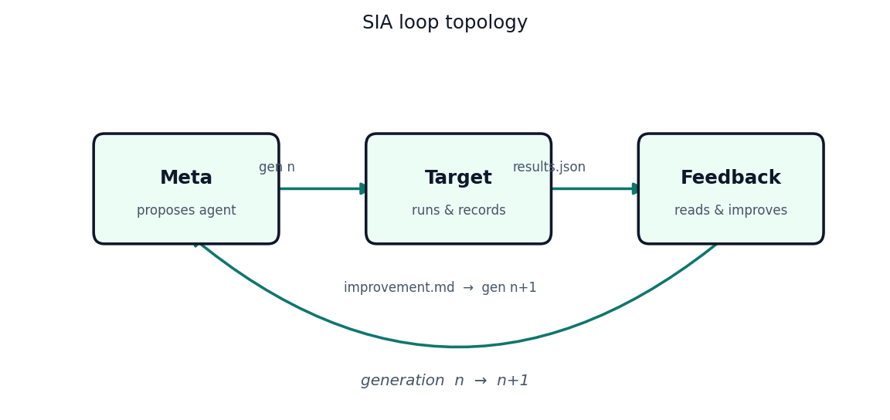

# Self-Improvement Agent Harness

The SIA exemplar replays recorded generations for a small threshold
classifier. Every bundled threshold scores the same on the held-out data,
so the result demonstrates reproducible evaluation and threshold robustness.
The optional local subprocess mode runs the bundled reference classifier.

- [Documentation index](docs/README.md)
- [Run, test, and render](docs/quickstart.md)
- [Manuscript](docs/manuscript/README.md)
- [Publication configuration](docs/publishing.md)

## Publication status

<!-- PUBLISHING-STATUS:START (generated by infrastructure.publishing.status_report) -->
**Self-Improvement Agent Harness: A Deterministic SIA Exemplar** · v0.1.2 · MIT · Daniel Ari Friedman

Concept DOI: [10.5281/zenodo.20453879](https://doi.org/10.5281/zenodo.20453879) | Version DOI: [10.5281/zenodo.20932066](https://zenodo.org/records/20932066) | Repository: [docxology/template_sia](https://github.com/docxology/template_sia)

Publishing surface — 20 platforms, 9 published:

| Platform | Tier | Status | Reference | Credentials |
| --- | --- | --- | --- | --- |
| zenodo | first-class | ✅ published | [10.5281/zenodo.20453879](https://doi.org/10.5281/zenodo.20453879) | `ZENODO_API_TOKEN` |
| github | first-class | ✅ published | [docxology/template_sia](https://github.com/docxology/template_sia) | `GITHUB_TOKEN` |
| arxiv | first-class | ⚪ available | — | — |
| pypi | first-class | ✅ published | [https://test.pypi.org/project/template-sia/0.1.2/](https://test.pypi.org/project/template-sia/0.1.2/) | `PYPI_TOKEN`, `TESTPYPI_TOKEN` |
| ipfs_pinata | first-class | ✅ published | [https://gateway.pinata.cloud/ipfs/QmccbCX9YXJMd3fNfkZ3H59dnWRnB6xgeVCM8kmPGQtaBh](https://gateway.pinata.cloud/ipfs/QmccbCX9YXJMd3fNfkZ3H59dnWRnB6xgeVCM8kmPGQtaBh) | `PINATA_JWT` |
| ipfs_web3storage | first-class | ⚪ available | — | `WEB3_STORAGE_TOKEN` |
| software_heritage | first-class | ✅ published | [https://archive.softwareheritage.org/browse/origin/?origin_url=https://github.com/docxology/template_sia](https://archive.softwareheritage.org/browse/origin/?origin_url=https://github.com/docxology/template_sia) | — |
| github_pages | first-class | ✅ published | [https://docxology.github.io/template_sia/](https://docxology.github.io/template_sia/) | `GITHUB_TOKEN` |
| cloudflare_pages | first-class | ⚪ available | — | `CLOUDFLARE_API_TOKEN` |
| netlify | first-class | ✅ published | [https://6a4442bb57aaff1e1b2992d1--tranquil-kleicha-0c9203.netlify.app](https://6a4442bb57aaff1e1b2992d1--tranquil-kleicha-0c9203.netlify.app) | `NETLIFY_AUTH_TOKEN` |
| huggingface_hub | first-class | ✅ published | [https://huggingface.co/datasets/ActiveInference/template_sia](https://huggingface.co/datasets/ActiveInference/template_sia) | `HUGGINGFACE_TOKEN`, `HF_TOKEN` |
| osf | first-class | ✅ published | [https://osf.io/85bxe/](https://osf.io/85bxe/) | `OSF_TOKEN` |
| amazon_kdp | documented | 🟡 planned | — | `AMAZON_KDP_EMAIL`, `AMAZON_KDP_PASSWORD` |
| google_play_books | documented | 🟡 planned | — | `GOOGLE_PLAY_BOOKS_SERVICE_ACCOUNT_JSON` |
| gumroad | documented | 🟡 planned | — | `GUMROAD_ACCESS_TOKEN` |
| leanpub | documented | 🟡 planned | — | `LEANPUB_API_KEY` |
| lulu | documented | 🟡 planned | — | `LULU_CLIENT_KEY`, `LULU_CLIENT_SECRET` |
| draft2digital | documented | 🟡 planned | — | `DRAFT2DIGITAL_API_TOKEN` |
| stripe | documented | 🟡 planned | — | `STRIPE_SECRET_KEY`, `STRIPE_PUBLISHABLE_KEY` |
| ingramspark | documented | 🟡 planned | — | `INGRAMSPARK_CLIENT_ID`, `INGRAMSPARK_CLIENT_SECRET` |

_Keywords: self-improvement agents, benchmark harness, reproducible research, agent evaluation._

_Status legend: ✅ published (durable identifier recorded in `config.yaml`) · 🔵 reserved (identifier reserved but not yet registered by final publication) · ⚪ available (adapter implemented and locally verifiable) · 🟡 planned. This block is generated — see the publication instructions to regenerate it._
<!-- PUBLISHING-STATUS:END -->
